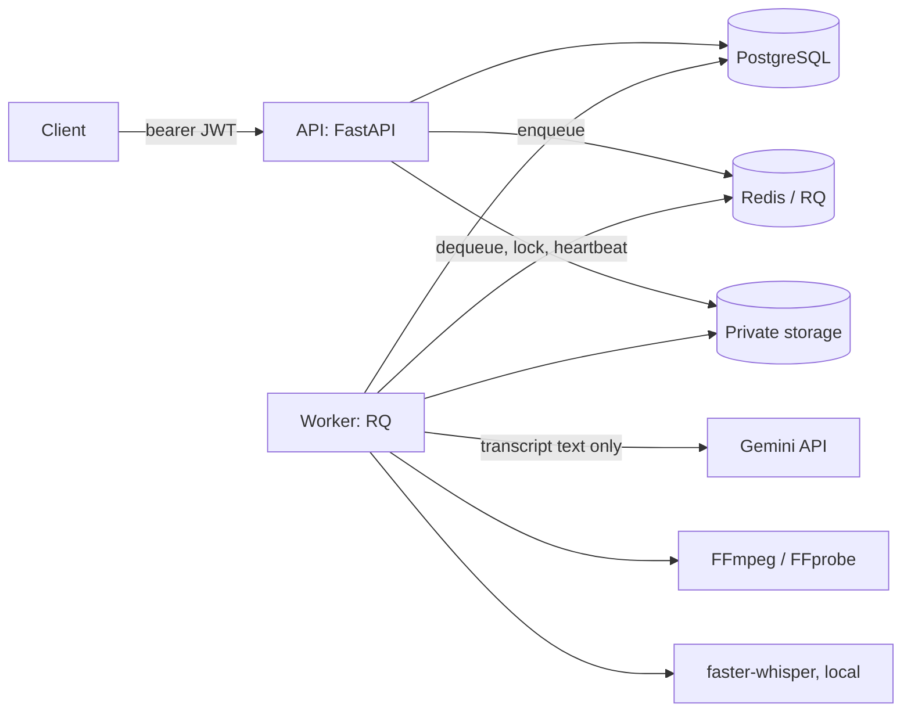
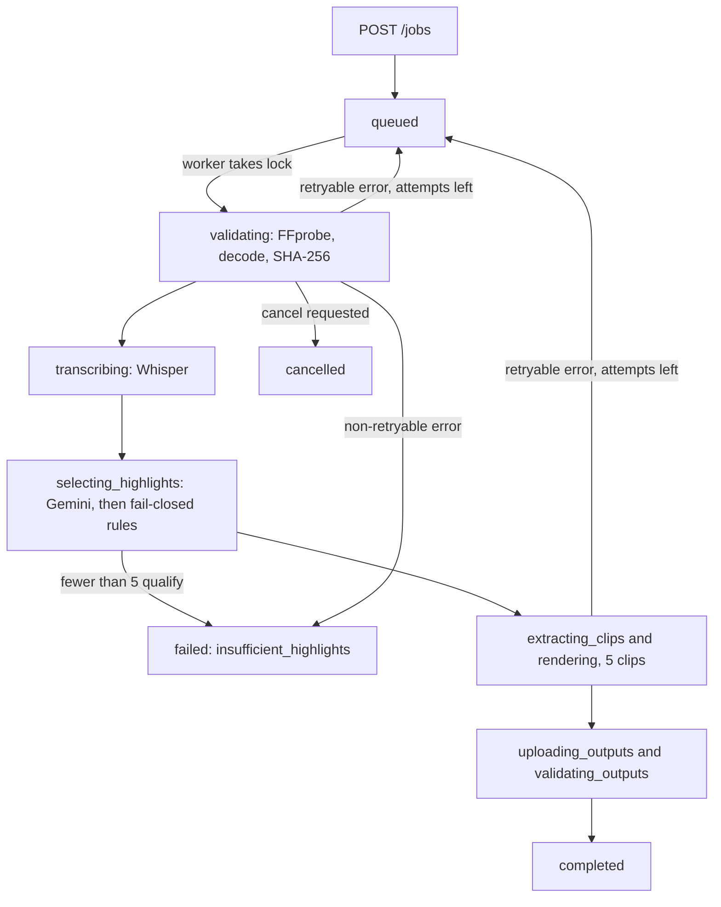

# Architecture

The backend has two processes built from one image: the **API** (FastAPI) and the **worker** (RQ). They share PostgreSQL for state, Redis for the queue and locks, and a storage backend for media.

## Job lifecycle

Retryable failures (provider timeouts and rate limits, temporary storage errors) return the job to `queued` with exponential backoff: 30 s, then 60 s, up to 900 s, for at most `MAX_JOB_ATTEMPTS` attempts. Non-retryable failures end the job as `failed` immediately with a specific code. The AI provider is also retried inside the analysis step before the job-level retry applies.

## Pipeline rules

These checks are what keep the output honest. Each is enforced in code and covered by tests.

1. **Media integrity before analysis.** A file is accepted only after FFprobe reads it, a decode check passes, and its SHA-256 is recorded.
2. **Retrieval only when permitted.** YouTube retrieval runs only when `YOUTUBE_RETRIEVAL_ENABLED` is set. Restricted, private, age-gated or DRM videos fail with a specific code. There is no cookie reading, login, CAPTCHA handling or protection bypass.
3. **Transcript-based analysis.** Gemini receives transcript text and timestamps. No audio or video is uploaded to it.
4. **Strict selection.** A candidate needs a score of at least `MIN_CLIP_SCORE` (75), a duration within `CLIP_MIN_SECONDS` to `CLIP_MAX_SECONDS`, timestamps that fall inside the source, and no overlap with a stronger selected clip. Duplicates are merged before selection.
5. **Exactly five or fail.** If fewer than five moments qualify, the job fails with `insufficient_highlights`. The system never pads with weak candidates.
6. **Validated outputs.** Each rendered clip is probed with FFprobe and must be 1080×1920 H.264 video, with AAC audio when the source has audio, before the job can complete.
7. **Idempotent retries.** Clip rows are keyed by `(job_id, clip_number)`. A retried job updates its clips in place rather than creating duplicates.
8. **Cancellation wins races.** A failure or completion that arrives after a cancel does not overwrite the cancelled state.

## Workers, locks and recovery

- Each job holds a Redis lock while it runs and refreshes a heartbeat every `HEARTBEAT_INTERVAL_SECONDS`.
- A periodic recovery pass finds running jobs whose heartbeat is older than `STALE_HEARTBEAT_SECONDS` and returns them to the queue. A worker crash therefore costs one retry, not a stuck job.
- Jobs queued for more than ten minutes are re-enqueued at most once per hour, so a backlog never multiplies queue entries.
- A job that runs past `JOB_TIMEOUT_SECONDS` is stopped and recovered the same way as a lost worker: retried while attempts remain, otherwise failed with `worker_lost`.
- Workers shut down gracefully on SIGTERM: in-flight jobs are not abandoned silently.

## Data model

The schema is in `migrations/001_studio_schema.sql`. Main tables:

| Table | Holds |
| --- | --- |
| `editing_sources` | Uploads and YouTube references, with FFprobe metadata, SHA-256 and status |
| `editing_jobs` | Job state, stage, progress, attempts, cancel flag, error code and message |
| `editing_job_events` | Timestamped progress and failure events shown on the job |
| `editing_highlights` | Scored candidate moments with selection and rejection reasons |
| `editing_clips` | The five outputs per job, with timing, render and validation status |
| `editing_worker_heartbeats` | Worker liveness for diagnostics |

Migrations are forward-only SQL files applied by `python -m app.migrate`, which records each applied version. Applying them is idempotent.

## Security model

- **Authentication:** HS256 bearer tokens with audience and expiry checks. Tokens are never logged.
- **Authorization:** every query is filtered by the owner ID from the token.
- **Storage:** private. Clients get only signed, short-lived links. Object keys are validated, and unsafe paths (`..`, absolute paths) are rejected before any I/O.
- **Uploads:** extension, MIME type and container signature must agree. Size and duration are capped.
- **FFmpeg:** inputs are local files only. URL protocols and arbitrary-file-read filters (`movie`, `amovie`) are rejected.
- **Secrets:** read from environment variables. Responses and logs contain no keys, and provider errors are mapped to safe messages.
- **Rate limiting:** per owner, per minute.
- **Headers:** responses carry `X-Request-ID`. Errors include the same ID for support.

## Configuration

Every variable is listed in `.env.example` with its default and whether it's required. Settings are validated at API and worker start-up; problems are reported together, and production refuses unsafe choices such as the fake AI provider or a non-HTTP database URL.
